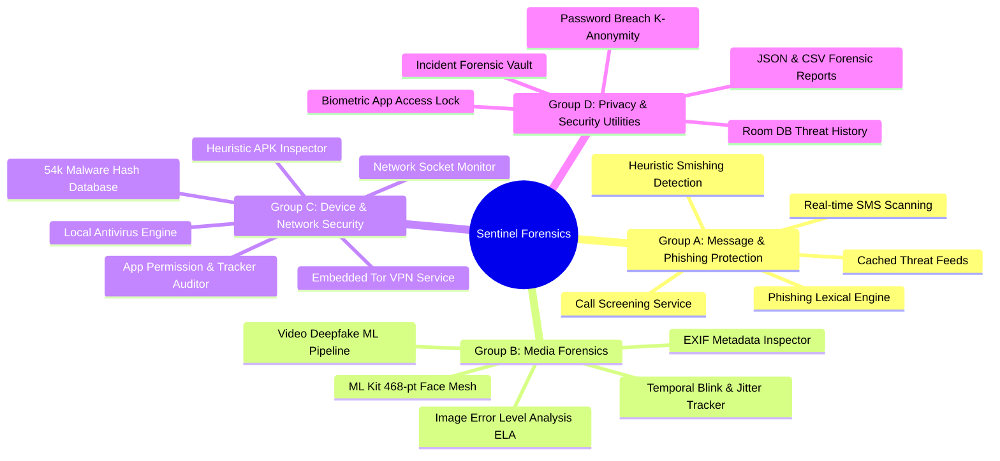

# Sentinel Forensics — Technical Project Overview

## 1. Application Identity & High-Level Objective

- **Application Name:** Sentinel Forensics (Internal project identifier: `DeepfakeShield` / `shieldapp-android`)
- **Package Name:** `com.deepfakeshield` (Debug variant: `com.deepfakeshield.debug`)
- **Repository Location:** `C:\Users\pvenk\Downloads\Sentinal Forensic` (Git Remote: `https://github.com/beenuar/shieldapp-android.git`)
- **Application Objective:** Sentinel Forensics is an on-device, offline-first mobile cybersecurity and digital forensic analysis suite for Android. The platform is engineered to inspect, correlate, and triage digital artifacts—including incoming messages, caller identities, URLs, multimedia files (images, audio, video), installed applications, and network connection states—without requiring constant cloud connectivity, external telemetry, or commercial threat intelligence APIs.

---

## 2. Problem Statement

Mobile devices are the primary locus of modern digital interactions, making them the foremost targets for sophisticated social engineering, deepfake media manipulation, smishing, vishing, malware delivery, and data exfiltration. Contemporary mobile security solutions present three critical systemic weaknesses:

1. **Cloud Dependency & Privacy Erosion:** Mainstream mobile security applications offload file hashes, scanned URLs, message contents, and call metadata to centralized vendor cloud servers for reputation analysis. This practice exposes sensitive user data to third-party telemetry, violates user privacy, and creates single points of compromise.
2. **Network Inoperability:** Cloud-dependent threat detection fails completely in air-gapped, low-bandwidth, roaming, or intentionally isolated operational environments where forensic triage is most urgently required.
3. **Fragmented Forensic Workflow:** Investigators and privacy-conscious users must juggle disparate, single-purpose utilities (EXIF viewers, APK analyzers, network loggers, and signature scanners), resulting in uncoordinated findings, broken chains of custody, and high operational overhead.

---

## 3. Research Motivation

The motivation behind Sentinel Forensics is to demonstrate that **comprehensive, multi-modal threat analysis and preliminary forensic triage can be executed entirely on modern mobile hardware**. By deploying lightweight on-device machine learning models (TensorFlow Lite, Google ML Kit Face Mesh), deterministic byte-pattern scanners, structural file parsers, and local heuristics directly on Android, Sentinel Forensics investigates whether an autonomous edge-first architecture can deliver actionable threat detection without surrendering privacy to cloud backends.

---

## 4. Target Users

1. **Everyday Mobile Users & Consumer Advocates:** Individuals seeking robust protection against SMS phishing (smishing), fraudulent robocalls, social engineering scams, and deceptive synthetic media without sharing personal contacts, messages, or photos with cloud security vendors.
2. **Corporate & Enterprise Personnel:** Employees handling sensitive business communications who require high-assurance privacy, protection against Business Email Compromise (BEC) and voice cloning scams, and strict compliance with zero-telemetry organizational policies.
3. **Digital Forensic Investigators & First Responders:** Field investigators conducting rapid, preliminary on-device triage of suspect devices, evaluating APK manifests, inspecting media metadata, analyzing network sockets, and cataloging timestamped evidence into a tamper-evident local vault.
4. **At-Risk Populations:** Journalists, activists, human rights defenders, and executives vulnerable to targeted surveillance, Pegasus-style spyware droppers, and state-sponsored digital harassment.

---

## 5. Platform Requirements & Build Configuration

Verified directly from project build configurations (`build.gradle.kts`, `app/build.gradle.kts`):

- **Target OS:** Android
- **Compile SDK Version:** `34` (Android 14)
- **Minimum SDK Version:** `26` (Android 8.0 Oreo)
- **Target SDK Version:** `34` (Android 14)
- **Application Version:** `1.0.0` (Version Code: `1`)
- **Programming Language:** Kotlin (Version `1.9.22`, jvmTarget `17`)
- **Java Compatibility:** Java 17 (JavaVersion.VERSION_17)
- **Android Gradle Plugin (AGP):** `8.2.2`
- **Gradle Version:** `8.5`
- **Build System:** Gradle multi-module project (16 Gradle subprojects)
- **Primary Build Artifact:** Verified existing debug APK at `app/build/outputs/apk/debug/app-debug.apk` (Size: ~423 MB / 443,672,491 bytes)

---

## 6. Language & Framework Stack

- **Core Language:** 100% Kotlin (198 Kotlin source files across modules)
- **UI Framework:** Declarative UI built with **Jetpack Compose** (Compose BOM `2024.06.00`, Kotlin Compiler Extension `1.5.8`)
- **Design System:** Material Design 3 (`androidx.compose.material3:material3`), Material Icons Extended
- **Dependency Injection:** Dagger Hilt `2.50` (`com.google.dagger:hilt-android`, `androidx.hilt:hilt-work:1.1.0`, `androidx.hilt:hilt-navigation-compose:1.1.0`)
- **Local Persistence:** Room Database `2.6.x` with SQLite abstraction and Jetpack DataStore Preferences
- **Asynchronous Execution:** Kotlin Coroutines (`kotlinx-coroutines-core:1.7.3`, `kotlinx-coroutines-android:1.7.3`) and Reactive State Flows (`Flow`, `StateFlow`, `SharedFlow`)
- **Background Orchestration:** AndroidX WorkManager (`androidx.work:work-runtime-ktx:2.9.0`)
- **Machine Learning Runtimes:**
  - TensorFlow Lite Android (`org.tensorflow:tensorflow-lite:2.14.0`, GPU Delegate `org.tensorflow:tensorflow-lite-gpu:2.14.0`, Support Library `org.tensorflow:tensorflow-lite-support:0.4.4`)
  - Google ML Kit Face Detection (`com.google.mlkit:face-detection:16.1.6`)
  - Google ML Kit Face Mesh Detection (`com.google.mlkit:face-mesh-detection:16.0.0-beta1`)
- **Network Anonymization:** Embedded Tor client via Guardian Project (`info.guardianproject:tor-android:0.4.7.14`, `info.guardianproject:jtorctl:0.4.5.7`) and Android `VpnService`

---

## 7. Architectural Paradigm: Offline-First vs. Cloud-Dependent Systems

### Contrasting Sentinel Forensics with Conventional Mobile Antivirus

| Architectural Dimension | Conventional Mobile Antivirus (e.g., Avast, Lookout) | Sentinel Forensics (Implemented Architecture) |
|---|---|---|
| **Threat Processing Location** | Remote cloud sandbox / vendor API servers | 100% on-device processing via local CPU/GPU |
| **Data Transmission** | Telemetry, URLs, hashes, and suspicious files uploaded | Zero mandatory uploads; telemetry disabled by default |
| **API Keys & Credentials** | Requires commercial SaaS keys / subscriptions | Operates completely free of commercial API keys |
| **Signature Matching** | Queries remote cloud hash database | Bundled asset database (`malware_hashes.txt`) & local SQLite |
| **Inference Engine** | Cloud-hosted LLMs / large vision transformers | Quantized on-device TensorFlow Lite & ML Kit Neural Nets |
| **Network Anonymity** | Standard cleartext routing or proprietary VPN tunnel | Embedded Guardian Project Tor binary (`libtor.so`) with local SOCKS5 proxy |
| **Data Persistence** | Multi-tenant cloud backend | Local SQLite Room Database encrypted on-device |

### Rigorous Scope of Offline Capability
The implementation source code verifies that:
1. **Fully Offline Modules:**
   - SMS scam & smishing analysis (`RiskIntelligenceEngine.analyzeText`)
   - URL lexical heuristic scoring (`UrlSafetyEngine.analyzeUrl`)
   - On-demand file & APK malware scanning (`AntivirusEngine`, `MalwareSignatureDatabase`, `HeuristicMalwareAnalyzer`, `YaraLikeRuleEngine`)
   - Image & screenshot forensics (`ImageForensicsEngine`, `PhotoForensicsScreen`)
   - Video frame deepfake analysis (`DeepfakeMLEngine`, `GovernmentGradeDeepfakeDetector`)
   - Installed application permission and tracker auditing (`AppAuditorScreen`)
   - Network socket / connection inspection (`NetworkMonitorScreen` via `/proc/net/tcp`)
   - Incident vault storage and CSV/JSON export (`VaultRepository`, `ExportManager`)
2. **Inherently Network-Dependent Operations (When Manually Triggered):**
   - Threat intelligence feed updates (`UnifiedUrlThreatCache.refresh` fetching from PhishTank, OpenPhish, URLhaus)
   - Embedded Tor proxy bootstrap and circuit building (`TorVpnService`, `EmbeddedTorService`)
   - Wi-Fi speed benchmarking (`WifiScannerScreen` downloading chunks from Cloudflare/Hetzner CDNs)
   - Security news feed fetching (`SecurityNewsScreen` reading public RSS feeds)
   - HaveIBeenPwned password breach checking (`PasswordCheckerScreen` using k-anonymity SHA-1 prefix queries)

---

## 8. Major Application Feature Groups

---

## 9. Security and Privacy Objectives

1. **Zero Unconsented Exfiltration:** Scanned files, call records, text messages, and photos never leave device storage.
2. **K-Anonymity External Verification:** Where external verification is provided (e.g., password checking), only 5-character SHA-1 prefixes are transmitted, preserving k-anonymity.
3. **Local Chain of Custody:** High-severity detections generate structured alerts and vault entries bearing timestamps, SHA-256 digests, and detailed indicator explanations.
4. **Biometric Data Protection:** Vault access and sensitive security screens can be locked behind Android BiometricPrompt authentication (`BiometricHelper.kt`).
5. **Network Identity Shielding:** Complete device network traffic can be routed through an embedded Tor client, concealing user IP addresses from external adversaries.

---

## 10. Research Contributions Supported by Source Code

The actual codebase supports the following verifiable research contributions:

1. **Feasibility of On-Device Multi-Modal Forensic Triage:** Proves that complex multi-modal analysis (text NLP heuristics, lexical URL parsing, computer vision face mesh tracking, and binary signature scanning) can execute locally on Android within consumer hardware constraints.
2. **Hybrid ML-Heuristic Pipeline for Media Authentication:** Implements a dual-engine architecture combining Google ML Kit neural networks (133 facial landmarks and 468 3D mesh points) with deterministic pixel heuristics (Error Level Analysis, discrete cosine/frequency energy distribution, and color channel entropy) to detect synthetic media artifacts without cloud offloading.
3. **Android-Constrained Defensive Architecture:** Demonstrates how system-level Android primitives (`CallScreeningService`, `NotificationListenerService`, `AccessibilityService`, `MediaProjection`, `VpnService`, and `PackageManager`) can be coordinated to deliver active protection within the constraints of modern Android sandboxing and permission policies.
4. **Offline Threat Signature Bundling:** Demonstrates a practical architecture for packaging binary hash registries (`malware_hashes.txt`) and in-process rule matchers (`YaraLikeRuleEngine`) directly inside Android APK assets to enable zero-network malware triage.

---

## 11. Current Development Status

- **Codebase Maturity:** Fully functional application prototype with 16 modular Gradle subprojects.
- **Compilation Status:** Compiles to a valid Android Debug Package (`app-debug.apk`, 423 MB).
- **Core Engine Verification:** Core text, URL, media heuristics, and UI flows are implemented and unit-tested.
- **Build Infrastructure:** Configured with GitHub Actions CI workflow (`.github/workflows/qa.yml`), Detekt static analysis (`config/detekt/detekt.yml`), and Android lint checks.

---

## 12. Known Limitations & Research-to-Code Discrepancies

1. **Absence of Server Corroboration-Weighted Correlation Engine:** The original IEEE manuscript describes a distributed server pipeline using Redis message queues, three parallel worker lanes, and a mathematical corroboration-weighted evidence correlation formula ($S = 1 - \prod (1 - m^+_f)$, $R = 1 - \prod (1 - m^-_f)$, $C = S(1 - R)$). **This distributed server architecture does not exist in the Android codebase.** The Android application uses local additive scoring and heuristic thresholding.
2. **Absence of Empirical Benchmark Evaluations:** The repository does not contain benchmark evaluation datasets (e.g., FaceForensics++, ASVspoof, Kaggle Phishing corpora). The reported Monte Carlo 50,000-item simulation from the paper is a standalone synthetic simulation and does not reflect Android hardware execution.
3. **Android Sandbox Constraints:** Non-root Android architecture prohibits universal inspection of third-party sandboxed app databases (e.g., WhatsApp, Telegram). Background inspection relies on notification listeners and accessibility hooks, which have explicit package exclusions.
4. **KAPT Stub Compilation Issue in Standalone Test Tasks:** While the debug APK builds successfully, running standalone unit test tasks on `:data` and `:av` currently encounters a javac stub resolution issue with KAPT-generated Room DAO implementations.
