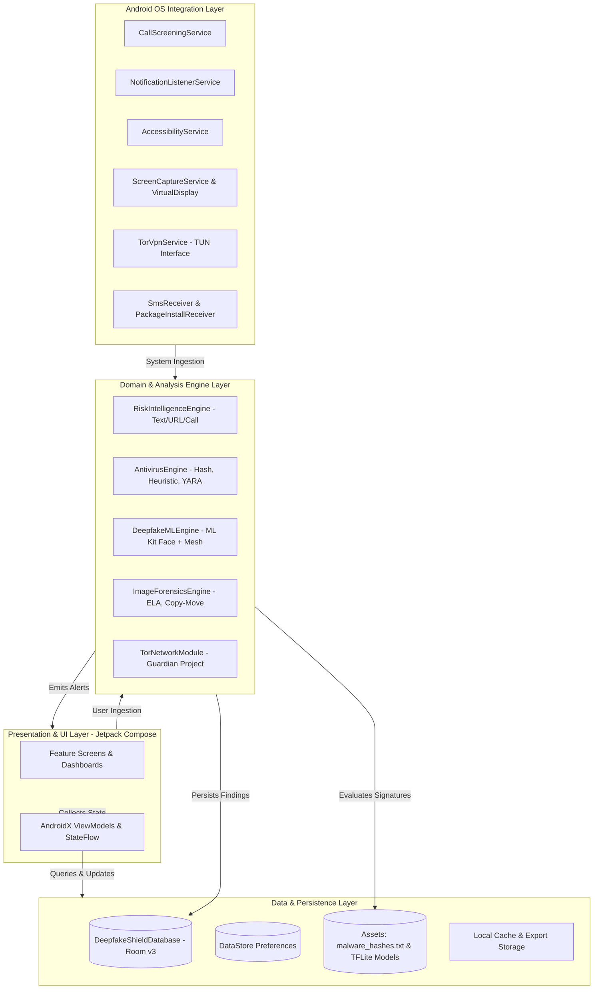
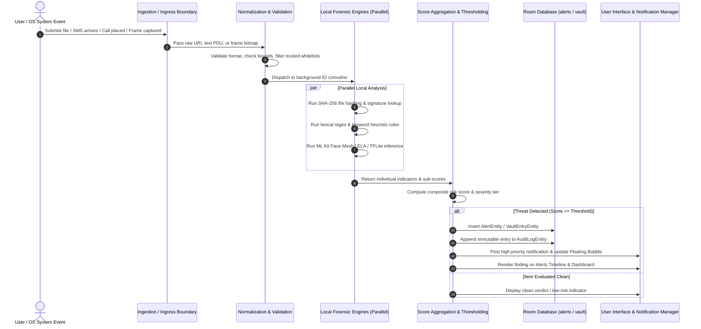

# Sentinel Forensics — Technical Architecture Specification

## 1. Architectural Philosophy: Offline-First Clean Architecture

Sentinel Forensics is built upon Android **Clean Architecture** principles structured as a multi-module Gradle project. The architectural goal is complete autonomy: threat ingestion, feature extraction, algorithmic scoring, database persistence, and forensic reporting occur directly within the Android client sandbox.

---

## 2. Component Hierarchy & Layering

The system decomposes into four distinct architectural tiers:

### 2.1 Presentation / UI Tier (`:feature:*`, `:core:ui`)
- **Framework:** Jetpack Compose with Material Design 3.
- **State Management:** Unidirectional Data Flow (UDF) utilizing Kotlin `StateFlow` and `SharedFlow`. ViewModels expose immutable UI State data classes (e.g., `VaultUiState`, `CallProtectionUiState`, `MessageShieldUiState`).
- **Navigation:** Single-activity host (`MainActivity`) with declarative routing managed by `androidx.navigation.compose`.

### 2.2 System Integration Tier (`:app`)
- **Telecom Subsystem:** `CallScreeningService` binds to Android Telecom Framework to evaluate incoming call handles.
- **Notification Subsystem:** `DeepfakeNotificationListenerService` observes status bar notifications.
- **Accessibility Subsystem:** `DeepfakeAccessibilityService` captures message view events from designated SMS apps.
- **Display Subsystem:** `ScreenCaptureService` uses `MediaProjection` to acquire live screen frames via a virtual display.
- **Network Subsystem:** `TorVpnService` configures an Android `VpnService` TUN interface routing device packets to local port 9050.
- **Background Orchestration:** `WorkManager` workers (`ScheduledScanWorker`, `DailyDigestWorker`, `InstallScanWorker`).

### 2.3 Domain & Forensic Analysis Tier (`:core`, `:ml`, `:av`, `:intelligence`)
- **`RiskIntelligenceEngine`:** Deterministic pattern evaluation for text urgency, OTP requests, financial pressure, and scam dial codes.
- **`UrlSafetyEngine`:** Lexical parsing of URLs (punycode, brand lookalikes, suspicious TLDs, excessive subdomains).
- **`AntivirusEngine`:** Multi-layer malware detection orchestrating exact SHA-256 hash lookups, high-specificity byte scanning, APK archive parsing, and YARA rule matching.
- **`DeepfakeMLEngine`:** 3D face mesh tracking, landmark geometry, temporal blink/jitter analysis, and pixel-level Error Level Analysis (ELA).
- **`ImageForensicsEngine`:** Pixel-grid spatial hashing for copy-move forgery, edge discontinuity detection, and luminance gradient analysis.

### 2.4 Persistence & Local Storage Tier (`:data`)
- **Relational Storage:** Room Database (`DeepfakeShieldDatabase` version 3, 16 entities, SQLite backend).
- **Configuration Storage:** Jetpack DataStore Preferences (`UserPreferences`).
- **Binary Assets:** Bundled SQLite/text database `malware_hashes.txt` (3.58 MB) and 13 TensorFlow Lite model files.

---

## 3. End-to-End Forensic Processing Workflow

The actual processing pipeline implemented in the codebase operates as follows:

### Detailed Pipeline Stages:
1. **Evidence Selection & Ingestion:**
   - On-demand user selection via Android `ActivityResultContracts.GetContent()` or `OpenDocument()` (images, videos, APK files).
   - Real-time system intercept via broadcast receivers (`SmsReceiver`), system-bound services (`CallScreeningService`), or screen streaming (`ScreenCaptureService`).
2. **Sanitization & Normalization:**
   - Text strings trimmed and normalized; phone numbers converted to E.164 format; URLs parsed to scheme, domain, and path components; bitmaps decoded with dimension bounding (downscaled to prevent memory exhaustion).
   - Exclusion filtering: Trusted package prefixes (`com.google.*`, `com.samsung.*`, etc.) bypassed for heavy heuristic checks to eliminate false positives.
3. **Parallel Local Analysis:**
   - Cryptographic Hashing: `MessageDigest.getInstance("SHA-256")` computes exact file digests.
   - Rule-Based Pattern Matching: Compiled regular expressions and binary pattern sets inspect text and bytecode.
   - Machine Learning Inference: Google ML Kit extracts facial landmarks and 468-point 3D mesh points; local TFLite models execute quantized tensor inference.
   - Pixel-Level Forensics: Error Level Analysis and block-hash copy-move algorithms compute compression and cloning anomalies.
4. **Risk Scoring & Thresholding:**
   - Findings aggregated into unified composite scores ($0–100$). Severity thresholds: Low (<30), Medium (30–59), High (60–79), Critical ($\ge 80$).
5. **Persistence & Audit Logging:**
   - If score exceeds alert threshold, structured `AlertEntity` is written to Room SQLite database.
   - Actions appended to `audit_log` table with timestamps and SHA-256 integrity digests.
6. **Reporting & Presentation:**
   - UI updates reactively via Room `Flow` observation.
   - User can trigger `ExportManager` to generate signed-off CSV or JSON incident reports shared via `FileProvider`.

---

## 4. Assessment of Research Paper's Evidence Correlation Model

### Status: NOT IMPLEMENTED IN ANDROID SOURCE CODE

The draft IEEE conference paper (*"Corroboration-Weighted Correlation of Forensic Engines, Threat Intelligence, and Local Models for Anti-Forensic Detection"*) describes a formal mathematical corroboration-weighted correlation model:
- Evidence grouped into five independent families: $F = \{\text{static}, \text{reputation}, \text{behavioral}, \text{structural}, \text{model}\}$.
- Per-family support and refutation calculations:
  $$m^+_f = 1 - \prod_{s \in f, p_s = +1} (1 - r_s q_s), \quad m^-_f = 1 - \prod_{s \in f, p_s = -1} (1 - r_s q_s)$$
- Cross-family overall support ($S$) and refutation ($R$):
  $$S = 1 - \prod_{f \in F} (1 - m^+_f), \quad R = 1 - \prod_{f \in F} (1 - m^-_f)$$
- Confidence formulation: $C = S(1 - R)$
- Coverage metric: $\gamma = |F_{resp}| / |F_{exp}|$
- Contested finding classification: $\min(S, R) \ge \tau$

### Explicit Audit Finding:
A comprehensive codebase grep for the terms `"corroboration"`, `"evidence family"`, `"contested"`, `"Fresp"`, and mathematical noisy-OR formulations **yields zero occurrences** in the Kotlin source files.

### What Actually Exists in the Code:
The Android application uses **deterministic additive heuristic scoring with conservative bounding**:
1. In `RiskIntelligenceEngine.kt`: Discrete indicator weights are summed and clamped to 100:
   $$Score = \min\left(100, \sum_{i} w_i \cdot \mathbb{I}(\text{indicator}_i)\right)$$
2. In `GovernmentGradeDeepfakeDetector.kt`: Heuristic analysis serves as the baseline ground truth, combined with TFLite model output via a maximum operation:
   $$Score_{visual} = \max(Score_{heuristic}, Score_{ML})$$
3. In `EnhancedRiskIntelligenceEngine.kt`: A multi-factor additive adjustment combines base risk with community and multi-lingual penalties.

**Recommendation for Paper Revision:** Claude must remove all representations that the Android application runs the 5-family corroboration-weighted Noisy-OR mathematical pipeline. Instead, the paper should present the implemented architecture: **an on-device multi-modal triage pipeline combining rule-based heuristics, neural face mesh tracking, and local signature databases, with the formal corroboration model proposed as theoretical future correlation layer.**

---

## 5. Android OS Integrations & Privacy Safeguards

1. **Sandboxed Data Boundary:** Sentinel Forensics operates entirely within standard Android Application Sandbox boundaries. It does not probe private app directories or require OS-level root privileges.
2. **K-Anonymity for Remote Verification:** Password breach lookups transmit only a 5-character SHA-1 prefix to HaveIBeenPwned API, ensuring full password plaintext and 35 characters of the hash never traverse the network.
3. **Tor Traffic Isolation:** The embedded Tor service runs locally via SOCKS5 proxy (`127.0.0.1:9050`). `TorVpnService` routes system traffic through Tor while explicitly excluding the app itself (`addDisallowedApplication`) to prevent proxy loops.
4. **Biometric Vault Protection:** Access to historical forensic alerts and vault entries can be gated by Android `BiometricPrompt` with hardware-backed keyguard fallback (`BiometricHelper.kt`).
5. **Secure Local File Sharing:** Exported forensic logs and reports are provisioned via `androidx.core.content.FileProvider` using private cache paths (`@xml/file_paths`), preventing insecure world-readable file exposures.
