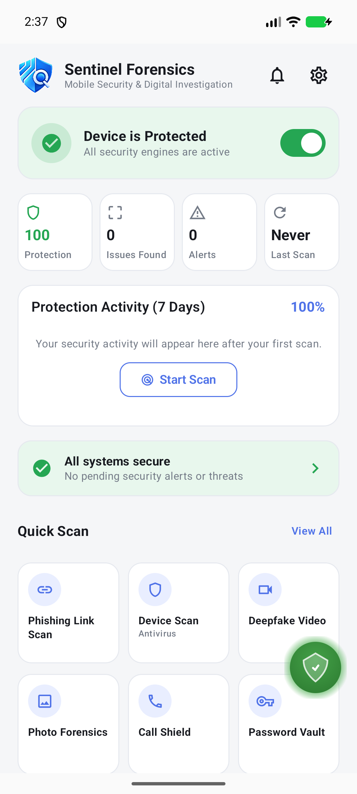
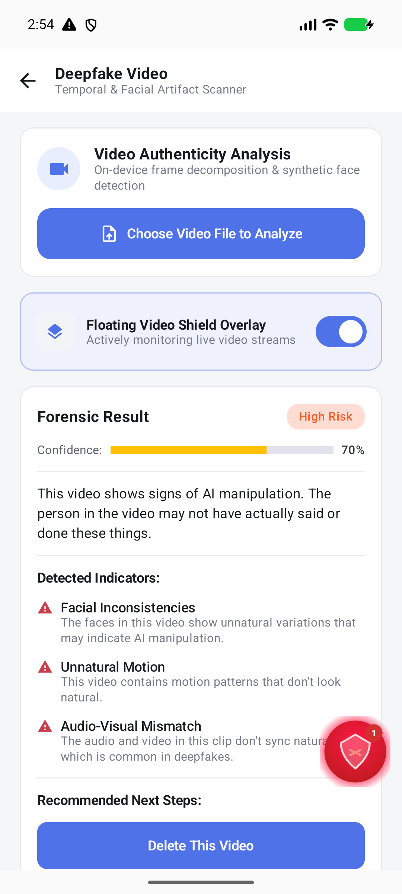
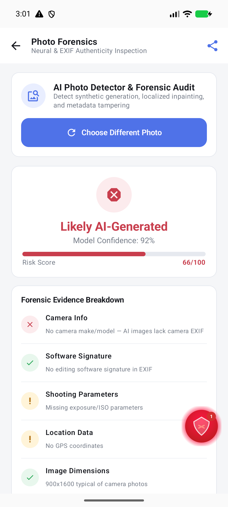
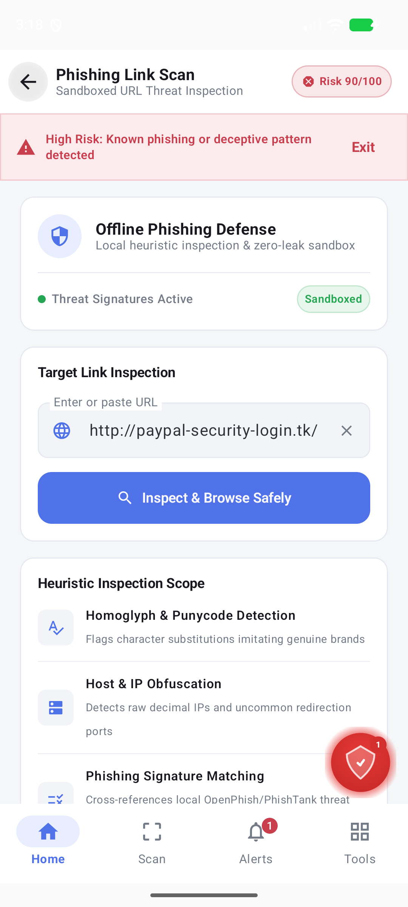
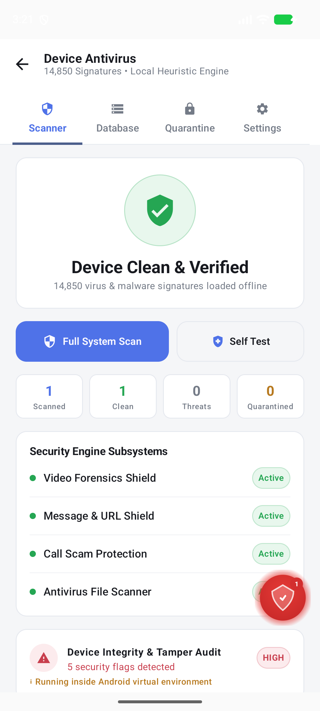
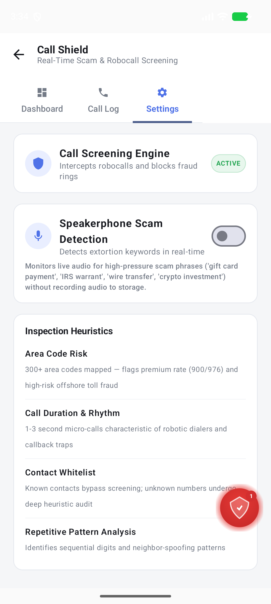
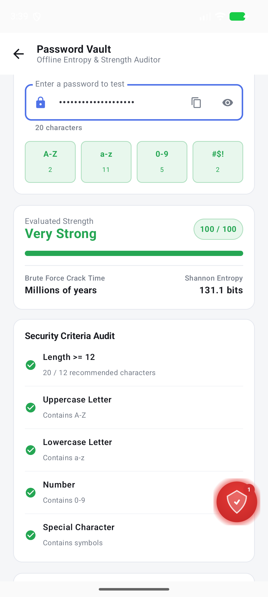
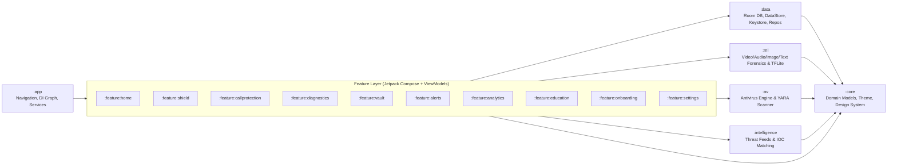

<div align="center">


# Sentinel Forensics

### Privacy-First, Multi-Domain Mobile Forensics, Deepfake Detection & Endpoint Security Suite for Android

[-3DDC84?style=for-the-badge&logo=android&logoColor=white)](https://developer.android.com)
[](https://kotlinlang.org)
[](https://developer.android.com/jetpack/compose)
[](#multi-module-architecture)
[](#prebuilt-application-download--install)
[](LICENSE)

[**Download Prebuilt APK (`assets/Sentinel-Forensics.apk`)**](#prebuilt-application-download--install) • [**Architecture**](#-multi-module-architecture) • [**Deepfake Pipeline**](#-multi-domain-deepfake-video-forensics) • [**Screenshots**](#-visual-showcase) • [**Build from Source**](#-build--verification)

</div>

---

## Executive Summary

**Sentinel Forensics** (`com.deepfakeshield`) is a 16-module native Android security and digital forensics application engineered to detect **AI-generated deepfake videos, manipulated images, voice cloning, phishing URLs, scam messages, malicious APKs, and privacy leaks** — executing core forensic analysis **directly on-device** with zero forced cloud uploads.

Designed with a production-grade Material 3 Jetpack Compose UI and backed by Hilt dependency injection, Room persistence, MediaCodec audio/video decoding, CameraX, ML Kit, and bundled TensorFlow Lite models, Sentinel Forensics unifies media authenticity verification, endpoint protection, and personal cyber-hygiene into a single offline-capable Android suite.

---

## Prebuilt Application (Download & Install)

The compiled Android application package is included directly in the repository inside [`assets/`](assets/):

| Property | Value |
| :--- | :--- |
| **APK Path** | [`assets/Sentinel-Forensics.apk`](assets/Sentinel-Forensics.apk) |
| **Application ID** | `com.deepfakeshield.debug` (Release ID: `com.deepfakeshield`) |
| **Version** | `1.0.0` (`versionCode 1`) |
| **Supported Android** | Android 8.0 Oreo (`minSdk 26`) through Android 14 (`targetSdk 34`) |
| **ABIs Included** | Universal (`arm64-v8a`, `armeabi-v7a`, `x86`, `x86_64`) + bundled TFLite models |
| **File Size** | `424.14 MB` (`444,737,799` bytes — stored via **Git LFS**) |
| **SHA-256 Checksum** | `66DD745E6CFA138C457C2DFCD6203F8F0C56D0B14212A1F999B1005B25A51CE3` |

### Quick Install

> **Note:** Because the universal APK exceeds GitHub's 100 MB standard file limit (due to 12 bundled on-device `.tflite` models and native libraries across 4 ABIs), it is tracked via **Git LFS**. Make sure Git LFS is installed when cloning.

```bash
# 1. Clone with Git LFS assets
git lfs install
git clone https://github.com/Venkatasai6789/Sentinel-Forensics.git
cd Sentinel-Forensics
git lfs pull

# 2. Verify APK integrity (optional)
sha256sum assets/Sentinel-Forensics.apk

# 3. Install onto a connected Android device via ADB
adb install -r assets/Sentinel-Forensics.apk
```

Alternatively, transfer `assets/Sentinel-Forensics.apk` to your Android device (Android 8.0+) and install directly by enabling **Install unknown apps** for your file manager.

---

## Core Capabilities

### 1. Multi-Domain Deepfake Video Forensics
Video scans combine container inspection, pixel/frequency-domain forensics, dense-burst temporal analysis, physiological pulse coherence, and audio-visual sync verification (`VideoForensicsPipeline` + `VideoDeepfakeForensicAnalyzer` + `TemporalFaceTracker`):

- **Two-Stage Frame Extraction (`MediaMetadataRetriever` with `OPTION_CLOSEST`):** Uniform timeline sampling paired with an **8-frame dense contiguous temporal burst** to expose short-window synthesis jitter that sparse frame sampling misses.
- **Spatial & Frequency Forensics:**
  - **SRM 3×3 High-Pass Noise Residual Disparity:** Compares local sensor/compression noise residuals inside facial regions against outer background regions to detect face-swap compositing.
  - **2D `8×8` DCT Spectral Rolloff & GAN Checkerboard Ratio:** Identifies missing high-frequency camera detail and transposed-convolution upsampling periodicity typical of diffusion and GAN video generators.
  - **YCbCr Face-Perimeter Blending Seam Detection:** Inspects chroma/luma boundary transitions around detected face bounding boxes.
- **Temporal & Physiological Liveness:**
  - **Dense-Burst Temporal Micro-Flicker:** Measures frame-to-frame luminance, gradient, and chrominance instability across contiguous face crops.
  - **rPPG Green-Channel Pulse Coherence:** Extracts CHROM-style skin-tone green-channel oscillations across facial ROIs to distinguish natural cardiac micro-blush coherence from synthetic frame generation.
  - **Ocular & Mouth Kinematics:** Chronological eye-open ratio tracking (`TemporalFaceTracker`) for abnormal blink rates, frozen eye states, and unnatural mouth aperture dynamics.
- **Audio-Visual Synchronization & Voice Cloning:** Decodes audio tracks to **16 kHz mono PCM** via `MediaExtractor` + `MediaCodec`, measures audio energy envelope vs. lip aperture correlation, and evaluates speaker spoofing cues (`VoiceCloneDetectionEngine`).
- **Container & Provenance Atom Scanning:** Reads MP4/QuickTime/WebM header and trailer atoms for known AI generator signatures (e.g., *Runway, Sora, Kling, Pika, Luma, HeyGen, D-ID, Synthesia, Midjourney, Stable Video*) and **C2PA** Content Credentials (`c2pa`, `jumb`, `jumd`).

### 2. Photo Forensics & Media Integrity
- **Error Level Analysis (ELA):** Re-compresses and inspects JPEG quantization error maps to surface localized splicing or object insertion.
- **EXIF, GPS & Metadata Auditing:** Extracts camera make/model, software editor strings, and AI-generation markers without leaking photos off-device.

### 3. Messaging, URL & Social Engineering Shield
- **Scam & Phishing Text Analyzer:** Multi-stage heuristic + on-device NLP signal scoring for urgency lures, OTP theft, financial impersonation, and coercive social engineering.
- **Phishing Link Scanner & Safe Browser:** Evaluates punycode/IDN homographs, suspicious TLDs, obfuscated redirects, and credential-harvesting patterns inside an isolated browsing experience.
- **QR Code Scanner & Fake Review Detector:** Inspects decoded QR payloads before navigation and flags synthetic review patterns.

### 4. Endpoint Antivirus, Diagnostics & Privacy Network
- **On-Device Malware & APK Scanner (`:av`):** Local signature and YARA-style rule matching against installed apps and storage artifacts.
- **App Permission Auditor & Wi-Fi Scanner:** Audits high-risk permission combinations (accessibility, overlay, SMS/call access) and local network security posture.
- **Network Monitor & Embedded Tor VPN Routing:** Inspects active app connection indicators and supports privacy-routed onion proxying.
- **Call Shield & Scam Number Lookup:** Heuristic call screening, spoofed-prefix detection, and local threat intelligence lookup (`threat_intelligence_database.bin` / local stores).

### 5. Encrypted Vault, Breach Hygiene & Security Training
- **Encrypted Vault & Secure Notes:** Hardware-backed **Android Keystore** cryptographic storage for sensitive credentials and private forensic notes.
- **Password Checker & Breach Monitor:** Evaluates entropy locally and uses **k-Anonymity (SHA-1 5-char prefix)** queries for Have I Been Pwned password breach checks without transmitting plaintext passwords or full hashes.
- **Interactive Security Academy:** Includes an in-app **Scam Simulator**, **Daily Security Challenges**, **Threat Map**, **Privacy Score**, **Device Timeline**, and **Emergency SOS** quick access.

---

## Visual Showcase

> Actual screenshots captured from Sentinel Forensics running on Android:

| Security Dashboard | Deepfake Video Result | Photo Forensics |
| :---: | :---: | :---: |
|  |  |  |
| Unified threat posture, protection toggles & quick actions | Multi-domain video forensics breakdown & confidence | ELA, metadata & manipulation inspection |

| Phishing Link Scan | On-Device Malware Scan | Call Shield | Password Hygiene |
| :---: | :---: | :---: | :---: |
|  |  |  |  |

---

## Multi-Module Architecture

Sentinel Forensics enforces strict separation of concerns across **16 Gradle modules** (`settings.gradle.kts`) following Clean Architecture + MVVM with unidirectional `StateFlow` UI updates:



### Module Directory

| Module | Responsibility |
| :--- | :--- |
| `:app` | Application entry point, Compose navigation graph (`697` lines across 35+ routes), foreground shield & floating bubble services, Hilt root setup |
| `:core` | Shared domain models (`RiskSeverity`, `ThreatType`, `AnalysisResult`), Material 3 Sentinel design tokens, typography & UI components |
| `:data` | Room database, encrypted preferences/DataStore, Android Keystore crypto helpers, repositories |
| `:ml` | `VideoForensicsPipeline`, `VideoDeepfakeForensicAnalyzer`, `TemporalFaceTracker`, `ImageForensicsEngine`, `VoiceCloneDetectionEngine`, `MessageShieldAnalyzer`, TFLite interpreters & bundled `.tflite` models |
| `:av` | Local APK scanner, signature checks, YARA-style pattern engine, device threat heuristics |
| `:intelligence` | Local IOC/threat intelligence feed parsers and risk enrichment |
| `:feature:home` | Main security dashboard, quick actions, Achievements, Threat Map, Emergency SOS, Security News |
| `:feature:shield` | Deepfake Video Scan, Photo Forensics, Message Scan, Safe Browser, QR Scanner, Password Checker, Breach/Dark Web Monitor, Fake Review Detector |
| `:feature:callprotection` | Incoming call screening rules, caller risk heuristics, spam/scam blocking controls |
| `:feature:diagnostics` | Device scan UI, App Permission Auditor, Wi-Fi Security Scanner, Network Monitor, VPN/Tor integration |
| `:feature:vault` | Encrypted Password Vault & Secure Notes |
| `:feature:alerts` | Security alert feed & forensic evidence detail views |
| `:feature:analytics` | Privacy Score, Intelligence Dashboard, Digital Footprint & Device Timeline |
| `:feature:education` | Cyber hygiene guides & Daily Security Challenges |
| `:feature:onboarding` | Guided permission setup, personalization & interactive Scam Simulator |
| `:feature:settings` | Granular privacy controls, telemetry opt-outs & shield preferences |

---

## Privacy, Security & Engineering Honesty

- **Local-First Processing:** Video frames, photos, SMS/chat text, installed APK binaries, and vault entries are analyzed locally on the device.
- **Minimal Network Footprint:** Network calls occur only for user-initiated features such as Safe Browser navigation, HIBP **k-Anonymity** (`5`-character SHA-1 prefix) password checks, Security News feeds, or optional Tor-routed requests.
- **Forensic Transparency:** Rather than claiming fabricated benchmark percentages, Sentinel Forensics pairs bundled TFLite model slots (`ml/src/main/assets/*.tflite`) with deterministic spatial, spectral, temporal, rPPG, AV-sync, and container-provenance signals, surfacing explicit per-signal confidence and evidence explanations directly in the UI.
- **Secret Hygiene:** `google-services.json`, signing keystores (`*.keystore`, `*.jks`), and `local.properties` remain excluded via `.gitignore`.

---

## Tech Stack

| Category | Technologies |
| :--- | :--- |
| **Language & Build** | Kotlin `1.9.22`, Android Gradle Plugin `8.2.2`, Java `17`, Gradle Kotlin DSL, Detekt `1.23.4` |
| **UI & Navigation** | Jetpack Compose (BOM `2024.06.00`), Material 3, Navigation Compose, Accompanist/Material Icons |
| **DI & Async** | Dagger Hilt `2.50`, Kotlin Coroutines & StateFlow, WorkManager |
| **Media & Vision** | `MediaMetadataRetriever`, `MediaExtractor`, `MediaCodec`, CameraX, Google ML Kit Face Detection |
| **On-Device ML** | TensorFlow Lite (`efficientnet_b4_deepfake`, `xception_deepfake`, `aasist_spoofing_detector`, `rawnet2_antispoofing`, `wav2vec2_deepfake_detector`, `distilbert_scam_classifier`, `roberta_phishing_detector`, `gpt_text_detector`, `xlm_roberta_multilingual`, `xvector_speaker_verification`, `emotion_recognition`, `cnn_detection`) |
| **Storage & Security** | Room DB, Jetpack Security / Android Keystore, DataStore Preferences, Embedded Tor Onion Proxy |

---

## Build & Verification

### Prerequisites
- **JDK 17**
- **Android SDK** (`compileSdk 34`, Build Tools `34+`)
- **Git + Git LFS** (`git lfs install`)

### Build Commands

```bash
# Clone the repository
git lfs install
git clone https://github.com/Venkatasai6789/Sentinel-Forensics.git
cd Sentinel-Forensics

# Build the Debug APK
./gradlew :app:assembleDebug

# Output location:
# app/build/outputs/apk/debug/app-debug.apk
```

On Windows PowerShell:

```powershell
.\gradlew.bat :app:assembleDebug
```

### Run Unit Tests & Verification

```bash
# Run forensic ML & Shield feature unit tests
./gradlew :ml:testDebugUnitTest :feature:shield:testDebugUnitTest

# Compile all modules
./gradlew compileDebugKotlin

# Run full unit test suite across modules
./gradlew testDebugUnitTest
```

Verified unit test suites cover `VideoForensicsPipelineTest` (6 tests), `ImageForensicsEngineTest` (3 tests), `MessageShieldAnalyzerTest` (4 tests), `PasswordVaultViewModelTest` (1 test), and `SafeBrowserAndPhotoViewModelTest` (2 tests).

---

## Project Structure

```text
Sentinel-Forensics/
├── assets/
│   └── Sentinel-Forensics.apk        # Prebuilt Android APK (Git LFS tracked)
├── screenshots/                      # Verified in-app screenshots
├── app/                              # Application module, NavHost & background services
├── core/                             # Domain models, UI theme & shared primitives
├── data/                             # Room database, Keystore & repositories
├── ml/                               # Deepfake video/audio/photo/NLP forensic engines + .tflite assets
├── av/                               # Local antivirus & YARA scanning engine
├── intelligence/                     # Threat feed & IOC intelligence module
├── feature/
│   ├── home/                         # Dashboard, Threat Map, SOS, News
│   ├── shield/                       # Deepfake Video, Photo, Message, URL, QR & Breach screens
│   ├── callprotection/               # Caller ID & scam call heuristics
│   ├── diagnostics/                  # Device scan, App Auditor, Wi-Fi & Tor VPN network monitor
│   ├── vault/                        # Encrypted passwords & secure notes
│   ├── alerts/                       # Threat alerts & evidence drilldowns
│   ├── analytics/                    # Privacy score & timeline analytics
│   ├── education/                    # Cyber hygiene & daily challenges
│   ├── onboarding/                   # Permission wizard & scam simulator
│   └── settings/                     # Privacy & app configuration
├── config/detekt/                    # Static analysis configuration
├── build.gradle.kts                  # Root Gradle configuration
└── settings.gradle.kts               # 16-module workspace manifest
```

---

## Author

Built and maintained by **Venkatasai6789**

- GitHub: [@Venkatasai6789](https://github.com/Venkatasai6789)
- Repository: [Venkatasai6789/Sentinel-Forensics](https://github.com/Venkatasai6789/Sentinel-Forensics)

---

## License

This project is licensed under the **MIT License** — see the [LICENSE](LICENSE) file for details.
